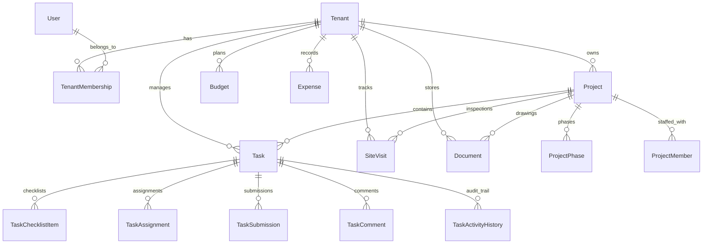

# 100% DESIGN Studio OS — Master Project Specification & Architecture Manual

**Project Name:** 100% DESIGN Studio OS (`miniEmployeeManagementSoftware`)  
**Domain:** Multi-Tenant Architecture, Interior Design & Employee Operations Platform  
**Current Version:** `3.1.0` (Production Enterprise Ready — Governed Project Lifecycle Matrix, Multi-Tenant Architecture OS, Ultra-Production Personal Workstation, Governed Task Workflow Lifecycle, Employee Self-Completion Access Mode, Four-Eyes Quality Gates, Project Commissioning & Handover Package, Owner Decision Inbox, and 3-Tier Profile Governance)  
**Primary Repository:** `c:\Users\ASUS\Desktop\miniEmployeeManagementSoftware`  
**Target Environment:** Node.js 20+, Next.js 16 (App Router with Webpack mode), React 19, TypeScript 5 (Strict), Tailwind CSS v4, Prisma ORM 6.4, MySQL 8.0+

---

## 1. Executive Vision & System Purpose

Architectural practices and interior design studios operate under distinct operational workflows that generic project management suites (Jira, Asana, Monday, ClickUp) cannot satisfy without awkward workarounds:

1. **Field vs. Studio Duality:** Site architects and project engineers constantly move between studio drafting tables and active construction sites where GPS accuracy fluctuates inside concrete basements or under steel structures. Operations require rapid geofenced check-in/out verification without battery-draining continuous background tracking.
2. **Strict Revision Control for Drawings:** Architectural drawings evolve through explicit, immutable revisions ($R_0, R_1, R_2, \dots$). Approval for $R_0$ must never implicitly carry forward to $R_1$.
3. **Four-Eyes Quality Gates (No Self-Approval):** Professional design governance requires that an architect or engineer who creates a drawing, delivers a specification, requests a scope change, or submits a task deliverable cannot approve their own submission. Reviewer $\neq$ Submitter.
4. **Governed Deliverable & Task Lifecycle:** Deliverables contain multiple checklist items assigned across different team members. Items progress through a rigorous 8-stage lifecycle: Assignment $\to$ Versioned Acknowledgement $\to$ Dependency-Checked Start $\to$ Clarification / Blocker Handling $\to$ Deadline Extension Gate $\to$ Versioned Snapshot Submission $\to$ Four-Eyes Review & Requested Changes $\to$ Automatic Deliverable Completion & Leadership-Only Reopen.
5. **Configurable Employee Self-Completion Access:** Currently configured via `ALLOW_EMPLOYEE_SELF_COMPLETION = true` in [`src/server/modules/tasks/repository.ts`](file:///c:/Users/ASUS/Desktop/miniEmployeeManagementSoftware/src/server/modules/tasks/repository.ts#L826). Employees and assignees can directly set their tasks and checklist items to `COMPLETED` from the Kanban board, status dropdowns, and Employee Dashboard "Mark Complete" shortcuts. This access can be instantly toggled back to strict Four-Eyes leadership approval at any time.
6. **Project Lifecycle Governance & Safety Gates:** Projects transition through formal stages: `DRAFT` (low barrier ideation) $\to$ `ACTIVE` (strict commissioning gates) $\to$ `ON_HOLD` (central operational freeze blocking check-ins, timers, and task assignments while permitting checkouts) $\to$ `COMPLETED` (mandatory gate requiring 0 active site visits, verified deliverables, and formal handover dossier) $\to$ `CANCELLED` (with work disposition `CANCEL_OPEN_TASKS` or `PRESERVE_SUBMITTED_WORK`) $\to$ `ARCHIVED` (reversible visibility toggle).
7. **Architectural Handover Package:** Automatic compilation of approved deliverables, GFC drawing revisions, achieved milestones, transmittal metadata, and client sign-off certification.
8. **Owner Decision Inbox:** Centralized review dashboard for Studio Owners and Administrators consolidating pending deliverables, deadline extensions, scope change requests, drawing revisions, site inspection audits, and official employee profile change requests.
9. **Commitment vs. Incurred Expense Segregation:** Contractor quotations represent contractual commitments, not actual money disbursed. Mixing contractor bids with incurred studio expenses distorts cash flow and profitability.
10. **Multi-Partner Studio Ownership:** Design practices typically operate with co-partners. Both require full Owner permissions, independent task views, and cross-partner delegation without administrative hierarchy collisions.
11. **3-Tier Profile Privacy & Official Record Governance:** 
    - *Self Profile:* Personal contact info editable directly by employees.
    - *Management Record:* Sensitive compensation, internal reviews, and HR notes visible strictly to Owners and Admins.
    - *Directory Profile:* Sanitized public directory with authentication credentials and MFA secrets stripped.
    - *Official Record Change Requests:* Changes to regulated fields (`designation`, `department`, `employeeId`) require formal change request submissions with Four-Eyes review.
12. **Multi-Tenant SaaS Foundation:** Built from the database schema up with logical tenant isolation (`tenantId`). Multiple studios operate securely on shared infrastructure with zero data bleed.

---

## 2. Technology Stack Matrix

| Layer | Technology | Version / Configuration | Purpose |
|---|---|---|---|
| **Framework** | Next.js (App Router) | `16.3.7` (`--webpack` mode) | Hybrid SSR/CSR, route groups, layout streaming, Server Actions |
| **Language** | TypeScript | `5.x` (Strict Mode) | End-to-end type safety across database, services, APIs, and client views |
| **UI Library** | React | `19.2.8` | Concurrent rendering, Server Components, client state hooks |
| **Styling** | Tailwind CSS & PostCSS | `@tailwindcss/postcss` `^4.0` | Modern CSS-first atomic styling, CSS variables, dark/light accents |
| **Design System** | Studio Blueprint Design System (SBDS) | Documented in [`DESIGN.md`](file:///c:/Users/ASUS/Desktop/miniEmployeeManagementSoftware/DESIGN.md) | Architectural precision tokens, container queries, high data density |
| **ORM / Database** | Prisma Client & CLI | `6.4.1` with MySQL 8.0+ | Strongly typed relational schema, migrations, connection pooling |
| **Authentication** | `jose` + `bcryptjs` | `jose ^6.2`, `bcryptjs ^3.0` | Stateless JWT tokens + DB-backed revocable sessions with role checks |
| **Validation** | Zod | `^4.6.5` | Strict schema validation for all API request bodies and query parameters |
| **Icons** | Lucide React | `^1.48.0` | Consistent, accessible architectural and operations iconography |
| **PWA & Offline** | Web Manifest + Service Worker | Native PWA (`manifest.ts`) | Installable desktop and mobile app experience |
| **Speech & Audio** | Web Speech API | Custom Speech-to-Text Engine | Hands-free on-site observation dictation with domain terminology support |
| **Geofencing & Mapping** | Haversine Formula + SVG Spatial Plot + OpenStreetMap | Custom Math Engine + Vector Canvas | Mathematical great-circle distance calculation, in-app boundary plots, reverse-geocoding |
| **Monitoring & Health** | Node.js HTTP Keep-Alive | `/api/health` | Sub-5ms ping endpoint for 24/7 uptime monitoring |
| **Testing** | Node.js Test Runner + `tsx` | Native `node:test` + `node:assert` | Multi-tenant isolation, security, and full workflow integration tests |

---

## 3. Architectural Principles & Golden Governance Rules

Every developer and engineer working on this codebase **must** adhere strictly to the following rules:

### 3.1 Mandatory Tenant Isolation
* Every database entity belonging to a studio includes a `tenantId String` foreign key.
* Every database query, mutation, and deletion **must** explicitly filter by `tenantId: ctx.tenantId`.
* **Never** query tenant records by primary key `id` alone. Always use `where: { id, tenantId: ctx.tenantId }`.

### 3.2 Natural Key Isolation via Composite Unique Indexes
* Natural identifiers must be unique **per tenant**, not globally across the entire database:
  * Projects: `@@unique([tenantId, code])`
  * Employees: `@@unique([tenantId, employeeId])`
  * Memberships: `@@unique([tenantId, userId])`
  * Drawing Versions: `@@unique([documentId, revision])`
  * Task Assignments: `@@unique([taskId, membershipId])`
  * Site Visit Events: `@@unique([tenantId, idempotencyKey])`

### 3.3 Four-Eyes Governance & Employee Self-Completion Mode
* **Standard Four-Eyes Rule:** A task submitter or document uploader can never approve their own work. An administrator or owner requesting a Scope Change Request or Official Profile Change Request can never approve their own request.
* **Employee Self-Completion Mode:** Controlled by `export const ALLOW_EMPLOYEE_SELF_COMPLETION = true;` in [`src/server/modules/tasks/repository.ts`](file:///c:/Users/ASUS/Desktop/miniEmployeeManagementSoftware/src/server/modules/tasks/repository.ts#L826).
  * *When enabled (`true`):* Employees/assignees can transition tasks and checklist items to `COMPLETED` directly. When completed, remaining checklist items and assignments on the deliverable are automatically closed, and pending approval requests are resolved.
  * *When disabled (`false`):* Re-enforces strict Four-Eyes leadership review gate where assignees cannot self-approve deliverables to `COMPLETED`.

### 3.4 Central Hold Action Policy
* Placing a project `ON_HOLD` freezes operational activity across the studio:
  - Blocks starting new billable timers.
  - Blocks creating or assigning new deliverables.
  - Blocks starting checklist items.
  - Blocks new site visit check-ins.
  - **Allows** active timers to be stopped and checked-in personnel to safely check out.
* Resuming from hold requires a documented rationale and atomically applies schedule adjustments to target dates.

### 3.5 Exact Decimal Precision for Financials
* Never use `Float` for money. Use Prisma `Decimal(15, 2)` across budgets, fee milestones, milestone payments, contractor quotations, and studio expenses.

### 3.6 Geofence & Concurrency Locks
* Site visit check-ins calculate the great-circle distance to the project's configured coordinates using the Haversine formula.
* An employee can have at most **one active checked-in visit** at any time. Opening a new visit requires completing or closing previous active visits.

---

## 4. Master Database Schema Specification (Prisma Data Dictionary)

The database schema ([`prisma/schema.prisma`](file:///c:/Users/ASUS/Desktop/miniEmployeeManagementSoftware/prisma/schema.prisma)) defines **46 models** across 9 operational domains:



### 4.1 Tenancy & Identity Domain
1. **`Tenant`** (`tenants`): Master tenant record. Includes `id`, `slug`, `name`, `timezone`, `currency`, `branding`, `lifecycleState` (`PROVISIONING`, `ACTIVE`, `SUSPENDED`, `DELETED`), and `settings`.
2. **`User`** (`users`): Global identity credentials. Includes `id`, `email`, `passwordHash`, `fullName`, `accountState` (`ACTIVE`, `DISABLED`), `mfaSecret`, `mfaEnabled`, `mfaRecoveryCodes`.
3. **`TenantMembership`** (`tenant_memberships`): Pivot linking user to tenant with authorization role: `role` (`OWNER`, `ADMIN`, `PROJECT_MANAGER`, `EMPLOYEE`), `status` (`ACTIVE`, `INACTIVE`), `joinedAt`.
4. **`Employee`** (`employees`): Studio personnel employment record. Linked to membership. Stores `employeeId` (unique per tenant), `designation`, `department`, `joiningDate`, `emergencyContact`, `sensitiveNotes` (management-only).
5. **`Session`** (`sessions`): Revocable user sessions with sliding expiry and IP/agent tracking.
6. **`TenantInvitation`** (`tenant_invitations`): Secure tokenized member invites with expiry.

### 4.2 External Directory Domain
7. **`Client`** (`clients`): Studio clients, developers, and homeowners with contact info.
8. **`Consultant`** (`consultants`): Specialist consultants (Structural, MEP, Acoustic, Façade).
9. **`Contractor`** (`contractors`): General and specialist trade contractors with compliance ratings.

### 4.3 Projects & Project Delivery Structure
10. **`Project`** (`projects`): Core project entity. Stores `code` (e.g. `PRJ-01`, unique per tenant), `name`, `status` (`DRAFT`, `ACTIVE`, `ON_HOLD`, `COMPLETED`, `CANCELLED`, `ARCHIVED`), `holdReason`, `cancellationReason`, `workDisposition`, `handoverDossier`, `clientSignedAt`.
11. **`ProjectMember`** (`project_members`): Staff assigned to project with role definitions.
12. **`ProjectPhase`** (`project_phases`): Delivery phases (Concept, Schematic, DD, GFC, Handover).
13. **`ProjectConsultant`** (`project_consultants`): Consultant contracts attached to project.
14. **`ProjectContractor`** (`project_contractors`): Contractor appointments per project.
15. **`Quotation`** (`quotations`): Contractor quotes and commitment sums.
16. **`ProjectChangeRequest`** (`project_change_requests`): Formal Scope Change Requests with impact analysis and Four-Eyes decision logs.
17. **`ProjectMilestone`** (`project_milestones`): Delivery milestones tracked against timelines.
18. **`ProjectTemplate`** (`project_templates`): Standardized architectural phase and task templates.

### 4.4 Tasks, Deliverables & Workflow Governance
19. **`Task`** (`tasks`): Operational deliverable. Stores `title`, `description`, `status` (`NOT_STARTED`, `IN_PROGRESS`, `IN_REVIEW`, `COMPLETED`, `CANCELLED`), `priority` (`LOW`, `MEDIUM`, `HIGH`, `URGENT`), `assigneeId`, `assignedMemberIds` (JSON multi-assignee array), `reviewerId`, `dueDate`, `version`, `completionDate`.
20. **`TaskChecklistItem`** (`task_checklist_items`): Granular deliverable breakdown assigned to specific members with prerequisite dependency tracking and blocker flags.
21. **`TaskAssignment`** (`task_assignments`): Member assignment metadata with versioned acknowledgement timestamps (`acknowledgedAt`, `acknowledgedVersion`).
22. **`TaskSubmission`** (`task_submissions`): Versioned snapshots of completed work submitted for review with attached evidence links and feedback logs.
23. **`TaskExtensionRequest`** (`task_extension_requests`): Formal deadline extension requests with reason and decision.
24. **`TaskClarification`** (`task_clarifications`): Technical questions regarding deliverables.
25. **`TaskClarificationReply`** (`task_clarification_replies`): Formal replies to clarifications.
26. **`TaskComment`** (`task_comments`): Deliverable discussion thread with author attribution.
27. **`TaskActivityHistory`** (`task_activity_history`): Immutable audit log of every workflow change, assignee modification, and blocker flag.

### 4.5 Sites, Field Geolocation & Verification
28. **`Site`** (`sites`): Physical construction site record with GPS coordinates (`latitude`, `longitude`, `radiusMeters`, `address`).
29. **`SiteVisit`** (`site_visits`): Field inspection session with check-in/out timestamps, GPS verification status (`WITHIN_RADIUS`, `OUTSIDE_RADIUS`, `MANUAL_OVERRIDE`), distance in meters, inspection notes, photos, and snags.
30. **`SiteVisitEvent`** (`site_visit_events`): Immutable check-in and check-out event ledger with idempotency keys.

### 4.6 Documents, Drawings & Revision Control
31. **`Document`** (`documents`): Master drawing sheet or technical document entity.
32. **`DocumentVersion`** (`document_versions`): Explicit revision ($R_0, R_1, R_2$) with file storage keys, sheet title, GFC status, and changelog.
33. **`ApprovalRequest`** (`approval_requests`): Formal Four-Eyes approval requests for drawings and deliverables.
34. **`PrivateFile`** (`private_files`): Encrypted studio file assets.

### 4.7 Finance & Commercial Ledger
35. **`Budget`** (`budgets`): Project budget ledger with cost categorization.
36. **`FeeMilestone`** (`fee_milestones`): Architectural client billing fee milestones.
37. **`FeePayment`** (`fee_payments`): Recorded client fee remittances with tax invoices.
38. **`Expense`** (`expenses`): Actual incurred studio operational and travel expenses.

### 4.8 Profiles & Official Record Governance
39. **`ProfileChangeRequest`** (`profile_change_requests`): Regulated changes to official employment records requiring Four-Eyes leadership decision.

### 4.9 Platform Operations, Notifications & Audit
40. **`Notification`** (`notifications`): In-app notification messages.
41. **`NotificationOutbox`** (`notification_outbox`): Reliable asynchronous notification dispatcher.
42. **`AuditEvent`** (`audit_events`): Global immutable compliance audit log.
43. **`Plan`** (`plans`): Commercial SaaS subscription tier configurations.
44. **`Subscription`** (`subscriptions`): Active tenant SaaS billing status.
45. **`TenantExport`** (`tenant_exports`): Full studio data export archive records.
46. **`DeletionRequest`** (`deletion_requests`): GDPR/data compliance tenant purge requests.

---

## 5. API Endpoints Inventory

### 5.1 Authentication & Workspace Session
* `POST /api/auth/login`: Authenticate with email/password, issue JWT cookie.
* `POST /api/auth/logout`: Revoke active session and clear authentication cookie.
* `GET  /api/health`: Ultra-fast (< 5ms) keep-alive health check for monitoring systems.

### 5.2 Task & Deliverable Governance
* `POST /api/tasks/create`: Create new deliverable with optional checklist items.
* `POST /api/tasks/update`: Full-fidelity deliverable edit (multi-assignee, priority, dates).
* `POST /api/tasks/status`: Transition deliverable workflow status (supports employee self-completion).
* `POST /api/tasks/acknowledge`: Formally acknowledge deliverable assignment.
* `POST /api/tasks/start`: Dependency-checked commencement of checklist work.
* `POST /api/tasks/checklist`: Update checklist item status, toggle completion, or report blocker.
* `POST /api/tasks/submit`: Submit completed work with evidence links for review.
* `POST /api/tasks/review`: Record leadership review decision (`APPROVE`, `REQUEST_CHANGES`).
* `POST /api/tasks/reopen`: Leadership reopen of completed deliverable with documented justification.
* `POST /api/tasks/reassign`: Reassign deliverable with team notification.
* `POST /api/tasks/delete`: Soft/hard delete deliverable with audit event logging.
* `POST /api/tasks/blocker`: Log or resolve operational task blocker.
* `POST /api/tasks/extension`: Request deadline extension.
* `POST /api/tasks/timer`: Start/stop billable Pomodoro and task timers.

### 5.3 Project Lifecycle & Commissioning
* `POST /api/projects/create`: Create project (supports lightweight `DRAFT`).
* `POST /api/projects/[projectId]/lifecycle`: Manage lifecycle transitions:
  - `COMMISSION`: Activate draft with strict field validation.
  - `HOLD`: Apply central operational hold with documented reason.
  - `RESUME`: Resume from hold with schedule adjustments.
  - `COMPLETE`: Safe completion with 0-visit verification and handover package.
  - `REOPEN`: Selective reopening of deliverables.
  - `CANCEL`: Cancellation with work disposition selection.
  - `ARCHIVE`: Toggle project archive status.
* `POST /api/projects/[projectId]/changes`: Submit or withdraw Scope Change Requests.

### 5.4 Owner Decision Inbox
* `GET  /api/inbox`: Fetch pending approvals across all 6 studio domains.
* `POST /api/inbox/decide`: Execute Four-Eyes review decision (`APPROVE` / `REJECT`).

### 5.5 Field Inspections & Geolocation
* `POST /api/visits/check-in`: Geofenced site visit check-in with Haversine distance verification.
* `POST /api/visits/check-out`: Complete site visit with photos, snags, and client notes.
* `POST /api/visits/export`: Export site visits to CSV with formula injection sanitization.

### 5.6 Profile & Team Operations
* `POST /api/profile/update`: Self-service employee contact info update.
* `POST /api/profile/request-change`: Submit official employment record change request.
* `POST /api/profile/decide-change`: Admin/Owner Four-Eyes decision on profile change request.

---

## 6. Implementation Phases & Completion Tracker

| Phase | Description | Status | Verification Evidence |
|---|---|:---:|---|
| **Phase 0** | **Design & Architecture**: ERD, ADRs, Tenant Isolation, Permissions, Threat Model | ✅ Completed | Documented in `docs/architecture/` |
| **Phase 1** | **SaaS Foundation**: Multi-tenant Prisma schema, migrations, DB seed, Auth, Session revocation | ✅ Completed | Multi-tenant auth and session revocation verified |
| **Phase 2** | **Connected Work**: Projects, Clients, Consultants, Contractors, Quotations, Tasks, Kanban | ✅ Completed | Integrated with permission gates |
| **Phase 3** | **Site Visits & Geolocation**: Geofence engine (Haversine), Concurrency locks, Admin reviews | ✅ Completed | 4/4 tests passing in `site-visits-and-workflows.test.ts` |
| **Phase 4** | **Documents & Finance**: Exact-revision approvals, Drawings, Budgets, Fees, Payments, Expenses | ✅ Completed | Decimal precision ledger and revision locking verified |
| **Phase 5** | **SaaS Commercial Lifecycle**: Plans, Quotas, Billing adapter, Tenant export & Deletion | ✅ Completed | Commercial models and export endpoints ready |
| **Phase 6** | **Production Hardening**: Isolation tests across tenants, ASVS verification, audit logs | ✅ Completed | Multi-tenant isolation verified |
| **Phase 7** | **Ultra-Production Personal Workstation**: Focus Mode, Billable Timer & Pomodoro, Velocity Metrics, 1-Click GPS Check-In, GFC Drawing Quick-Viewer, Field Scratchpad | ✅ Completed | Integrated on employee workstation dashboard |
| **Phase 8** | **End-to-End Employee Task Workflow & Governance**: 8-stage lifecycle from Assignment to Completion & Reopen | ✅ Completed | 16/16 tests passing in `employee-task-workflow.test.ts` |
| **Phase 9** | **Comprehensive Project Lifecycle & Profile Governance**: Incomplete Drafts, Commissioning, Scope Changes, Four-Eyes, Central Hold Policy, Handover Package, Safe Completion, Selective Reopen, Cancellation, 3-Tier Profile Privacy, Official Record Changes | ✅ Completed | 20/20 tests passing in `project-lifecycle-and-profiles.test.ts` |
| **Phase 10** | **Operations Polish & Universal Access Mode**: Owner Decision Inbox, Universal Voice-to-Text with Auto-Correction, Employee Self-Completion Mode (`ALLOW_EMPLOYEE_SELF_COMPLETION = true`), Dashboard Quick-Actions | ✅ Completed | Live in production code |

---

## 7. Automated Test Suites & Quality Verification

All test suites run against the live MySQL database (`studio_os_db`) using the native Node.js test runner:

```powershell
# 1. Project Lifecycle & Profile Governance Suite (20 Tests)
node --import tsx --test tests/project-lifecycle-and-profiles.test.ts

# 2. End-to-End Employee Task Workflow Suite (16 Tests)
node --import tsx --test tests/employee-task-workflow.test.ts

# 3. Site Visits, Geolocation & Concurrency Suite (4 Tests)
node --import tsx --test tests/site-visits-and-workflows.test.ts

# 4. Global TypeScript Typecheck (0 Errors)
npx tsc --noEmit
```

---

## 8. Seed Accounts & Verification Credentials

### Tenant 1: `100percentdesign` (100% DESIGN Studio)
* **Co-Owner / Principal Architect (Ar. Saksham Lanjewar):**
  * Employee ID: `EMP-001` | Role: `OWNER` | Password: `Password123!`
* **Co-Owner / Partner 2:**
  * Employee ID: `EMP-002` | Role: `OWNER` | Password: `Password123!`
* **Studio Admin:**
  * Employee ID: `EMP-003` | Role: `ADMIN` | Password: `Password123!`
* **Project Architects / Employees (Vedant, Appi, Ananya):**
  * Employee IDs: `EMP-004`, `EMP-005` | Role: `EMPLOYEE` | Password: `Password123!`

---

## 9. Local Development & Runbook

1. **Install Dependencies:**
   ```powershell
   npm install
   ```
2. **Database Push & Client Generation:**
   ```powershell
   npx prisma db push
   npx prisma generate
   ```
3. **Seed Database:**
   ```powershell
   npm run db:seed
   ```
4. **Typecheck Codebase:**
   ```powershell
   npx tsc --noEmit
   ```
5. **Start Development Server:**
   ```powershell
   npm run dev
   ```
   *Available at `http://localhost:3000` (or `http://localhost:3001` if port 3000 is occupied).*
